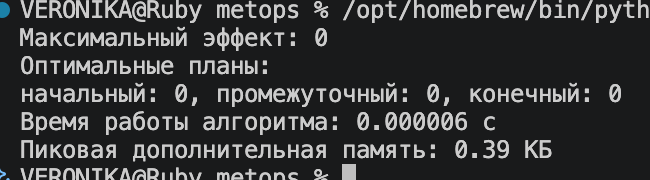
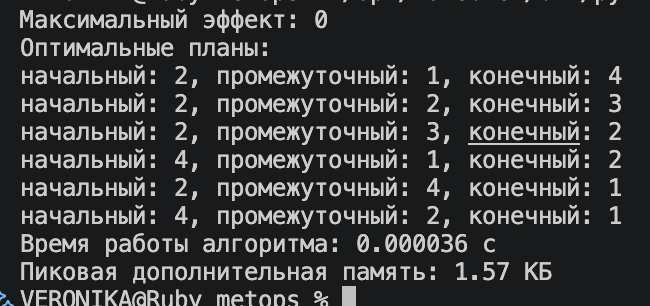

# Сусликова Вероника Денисовна    467632  МетОпт 1.1    

Карта

- dinamo.py - код решения
- Отчет МетОпт Лабораторная 4.pdf - отчет

### Как использовать код решения?

Код решения нужно загрузить и запустить. В консоли вам не надо будет вводить задачу, на данный момент код не адаптирован под ручной ввод условий

Ссылка на подкаст для доп. баллов: https://drive.google.com/drive/folders/1nojiXqMSDEGQD0sa93LUJdoLndyzDgyQ?usp=sharing

### Дополнительные тесты:

Я попыталась, на основе тестов, расписаных в примере, придумать тесты для данной программной реализации, благодаря чему смогла подправить код для обработки нестандартных случаев:

1) Рейсов 0: Ожидаем, что код выдаст максимальный эффект 0 и нулевые значения рейсов на всех этапах в оптимальном плане

2) Все станции имеют нулевой эффект: ожидаем, что сохранятся все планы, так как выдают одинаковый максимальный эффект 0

3) Отрицательные значения эффекта обрабатыватся обычно, поскольку данные не имеют ограничений на данные значения, максимальный эффект и оптимальные планы пересчитываются соответсвенно

